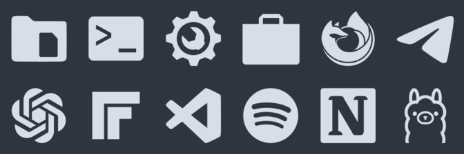

# Monochrome-Cosmic

A monochrome icon theme built for the COSMIC desktop. Every icon —
apps, panel applets, settings pages, file types — is the same
single-color glyph, so the whole desktop reads as one set instead of
a shelf of colorful logos.



## Why

COSMIC ships a colorful default icon set. This theme replaces it
with one consistent style: each application's real logo, redrawn or
converted to a single-color SVG glyph (`currentColor`, scheme color
`#d8dee9`) on a transparent background. No background plates, no
gradients, no per-app color accents.

The set is designed for dark COSMIC themes, panels, and docks.

## COSMIC integration

- Installs as a standard freedesktop icon theme and is selected in
  **COSMIC Settings > Desktop > Appearance > Icons and toolkit
  theming** — no patches, no per-app edits.
- Covers the COSMIC desktop itself, not just third-party apps:
  Files, Terminal, Settings and every Settings page, Store, Text
  Editor, App Library, Launcher, Workspaces, Screenshot, and Media
  Player all have matching glyphs.
- Panel and dock applets are mapped too, including the symbolic
  names COSMIC requests (`com.system76.CosmicApplet*-symbolic`), so
  nothing in the panel falls back to a colorful icon.
- GTK and Flatpak applications use the same theme through the
  freedesktop icon lookup, so one selection styles everything.
- Optional: the boot splash can match as well. See
  [docs/PLYMOUTH.md](docs/PLYMOUTH.md) for the monochrome
  Plymouth variant of the CachyOS "dreamboat" boot animation.

## Install

```bash
git clone https://github.com/firzadev-afk/Monochrome-Cosmic.git
cd Monochrome-Cosmic
bash scripts/install.sh
```

The installer symlinks the theme into `~/.local/share/icons/`, so
the installed theme and this repository stay the same files. Then
select **Monochrome-Cosmic** in COSMIC Settings. If icons do not
refresh, log out and back in once — COSMIC's panel, launcher, and
app library cache icons in memory.

## Adding an icon

One real file per logo; every other name an app uses for that logo
is a symlink. New icons must follow [docs/STANDARDS.md](docs/STANDARDS.md):
source the app's real logo first, make it monochrome at the house
canvas and color, and verify it still reads as the same app at
24 px. This repository ships an agent skill for exactly that job
under [`skills/monochrome-icon-forge`](skills/monochrome-icon-forge/SKILL.md).

## Upstream

The artwork originates from YAMIS (Yet Another Monochrome Icon
Set) by Dirn, maintained on Bitbucket:
<https://bitbucket.org/dirn-typo/yet-another-monochrome-icon-set>

`scripts/import_yamis.py` re-imports a fresh upstream clone with
deduplication: files whose content is identical collapse to one
real file plus symlinks, and the COSMIC-specific mappings maintained
in this project are layered on top. Application logos remain the
trademarks of their respective owners.

## Repository layout

```text
theme/     installable icon theme (index.theme + context folders)
assets/    preview images
docs/      standards and design documents
scripts/   installer and upstream import tooling
skills/    agent skill for creating new icons
```

## License

GNU General Public License v3, consistent with the original YAMIS
source. See [LICENSE](LICENSE). Original authors are credited in
[AUTHORS.md](AUTHORS.md).
